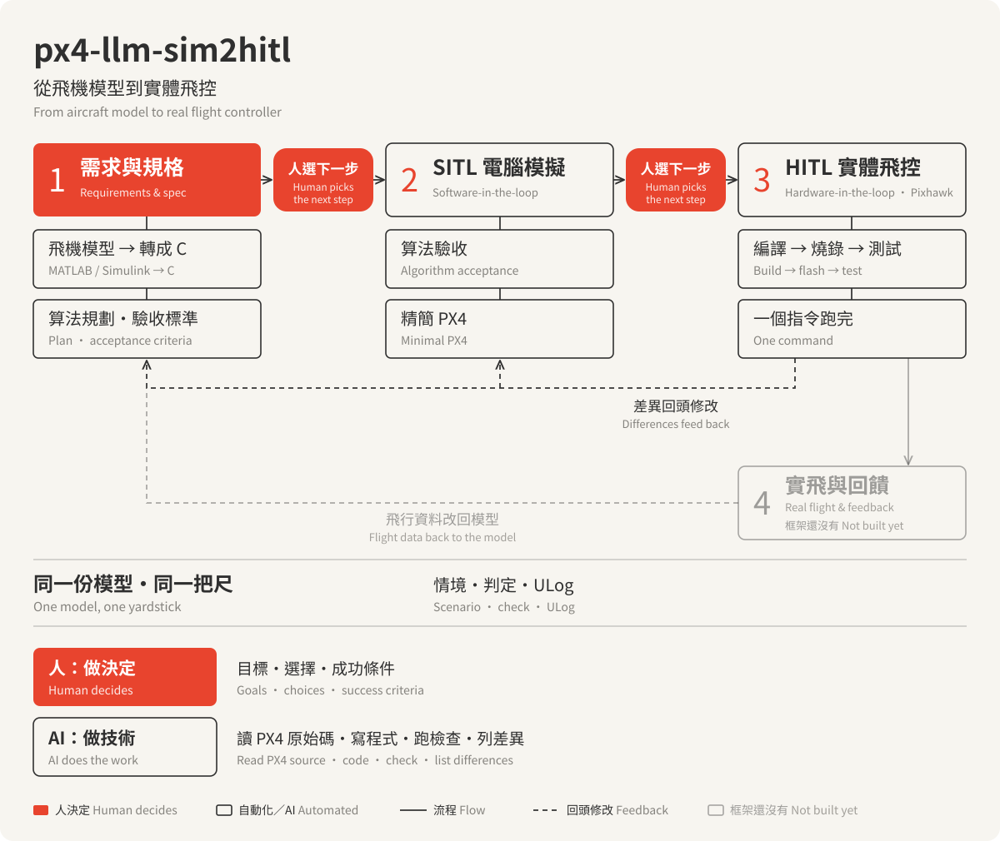

# px4-llm-sim2hitl

[繁體中文](README.md) | **English**

> **This is a translation.** The authoritative README is [README.md](README.md) (Traditional Chinese); where the two differ, follow README.md. Translated from README.md with SHA-256 `0206773fb4a17caf4d4b1e25943083b140ccffb72b38f14b0dcf54c6127cd0ba`: if `sha256sum README.md` prints something else, this translation is behind. The AI rules ([AGENTS.md](AGENTS.md)) and the folder READMEs are in Traditional Chinese only; an AI agent reads them without trouble.

Flight-control development kit: MATLAB/Simulink aircraft model → C → SITL (minimal PX4) → custom PX4 firmware → HITL on a real flight controller (Pixhawk). When you develop with an AI, its working rules are in [AGENTS.md](AGENTS.md).



**The example aircraft is SkySurfer** (fixed-wing): `model/`, `hitl/aircraft/skysurfer/`, the model release names `skysurfer-…` and `SkySurfer_Core` belong to the aircraft. The kit is called `px4-llm-sim2hitl`: folders use the full name (on Linux `~/.cache/px4-llm-sim2hitl`, `~/.local/share/px4-llm-sim2hitl/venv`, `~/.config/px4-llm-sim2hitl`; `./runbridge where` shows this machine's actual locations), environment variables the short name `SIM2HITL_*` (environment variables cannot contain a hyphen). To use your own aircraft, see stage 1.1.

> Status: the move from the old macOS project to Ubuntu is done and the whole pipeline runs (see the last section). On 2026-10-20 a second flight controller, the Cube Orange+, also went through one full round; what to check when changing flight controllers is in [fc/](fc/README.md).

## Getting started

**Just paste this link to your AI.** It reads this README and [AGENTS](AGENTS.md); from then on you only say what you want to do.

- **Only want to understand it**: any AI that can read web pages will do; ask it "what is this and what can it do for me".
- **Want to develop**: use an AI that can run commands on your computer (for example Claude Code or Codex). Paste the link the same way and ask it to download the repo to a fixed folder on your computer (do not move it later; to move it, recover first as AGENTS says).
  - The first time: say "set this computer up following the README's environment setup". It checks item by item and asks you to paste once when it needs sudo or a permission. **The whole pipeline is verified only on Ubuntu 24.04 (x86-64)**; macOS (Apple silicon) is verified up to SITL (see "Verification matrix" and [platforms/macos.md](platforms/macos.md), in Traditional Chinese); other systems are untested, the AI will try following the official docs, but expect extra time on pitfalls.
  - After that: just say what you want, for example "I want to switch to my own aircraft" or "I want to build a new guidance algorithm". It starts the conversation at stage 1, "Requirements and spec".
- **Use a capable AI**: it has to read long documents, write code, run commands and understand the results. A model that is too small, or set to low reasoning, tends to skip the docs and guess. Tested and works: GPT-6.1 sol (reasoning: medium).

Example opening: "Please download https://github.com/rhyne1012/px4-llm-sim2hitl to ~/Developer, read the README and AGENTS first, then talk with me about stage 1: I want to ..."

## The spirit of this project

**This is not an automation toolkit, and it should not grow into one that tries to cover every development case; it is a handover that lets your AI understand this pipeline from the start.** How the path goes from the aircraft model, the PX4 source, SITL, building and flashing to the real flight controller, where the traps are, what has already been verified and what counts as right are all written down in the docs (this README, [AGENTS.md](AGENTS.md), the folder READMEs) and in the existing checks. Once your AI has read them it can pick up where things stand without working out the whole pipeline from scratch each time, and spend its time and tokens on the real work: debugging and developing with you.

An analogy: every new conversation, your AI is like a colleague on their first day at work. This package is the handover left by the people before: how the system works, where the traps are, what has already been verified, the house rules, and one basic route that has actually been run end to end (model → SITL → flashing → HITL). A handover does not do the work for the newcomer, nor does it list every situation they will meet; it lets them put their mind on your problem from day one, and know where to start when something new comes up. New lessons and the rules agreed with you go back into the handover, so the next newcomer gets up to speed faster.

- **Understanding first, tools second**: commands and scripts only fix steps that are already understood. The docs say why things are done this way and where the traps are, for example the SD-card read error, the ground model that never turns the aircraft, and when the wind starts. That way the AI knows where to look when something goes wrong, and does not force things through by bypassing a safety check.
- **A conclusion is as big as its evidence**: every conclusion can name its basis (which test, which record) and its scope (version, recipe, FC, mode); with little evidence, make the claim smaller rather than run more tests. Seeing no difference is not the same as there being none; SITL and HITL share one aircraft model, so agreement between them does not prove the model is like the real aircraft; when the conditions change, old conclusions are checked again. How the AI does this: [AGENTS](AGENTS.md) "下結論之前" (before concluding).
- **Purpose**: hand this package to someone else so that they and their AI can go from changing the aircraft model and developing flight control all the way to building, flashing and HITL.
- **Simple, light, one source**: everything lives in one place; reuse existing programs and checks; add nothing for cases that may never come.
- **The AI speaks plainly**: the AI looks up and handles the technical details; it asks the human only about goals, choices and success criteria.
- **Stage 1 matters most**: the AI first reads the PX4 source of the locked version, lays out the feasible ways to plug in in plain words, and the human chooses; then it suggests a "minimal end-to-end run" first, so the whole path works and is recorded, and later changes go through the automation.
- **Stage 3 in one go**: build → flash → identity check → parameters → boot file → HITL → flight log, in one command; before starting, tell the human what is on the FC now, then always flash again (when only an external module changed, the version hashes the FC reports may stay the same, so old and new cannot be told apart).
- **Automation grows with the development**: tools are a by-product of understanding. When the same thing has been done two or three times, the AI suggests turning it into a command or script in the project, and the human decides; fewer tokens the more it is used.
- **Environment not hard-coded, pass criteria hard-coded**: paths, compiler, MATLAB and the PX4 source tree are found automatically and can be set; when changing platform, ask the AI to check the official docs. The yardsticks (version lock, check tolerances, 4 ms, load thresholds) do not change with the environment.
- **No permission levels**: at the end of each stage ask "next step 1/2/3"; no item-by-item questions within a stage. The runtime safety checks (FC identity, disarmed, read-back, recovery) cannot be bypassed; see AGENTS section 3.
- **Remind, don't block**: non-default flight parameters run and are recorded; whatever looks wrong is told to the human, who decides.
- **SITL and HITL use the same yardstick**: the same scenario, the same judging program, the same kind of log (ULog); the difference between the two is itself the information you are after. "The same yardstick" means a requirement has the same definition, baseline and judgment on both sides; only requirements both sides can measure are compared side by side. For example the reduced SITL has no EKF and no Commander, so how OFFBOARD exits can only be answered in HITL.

## Pipeline

1. **Requirements and specification**: agree first on what to do and what counts as success.
   - 1.1 Aircraft model and trim (when changing the aircraft or the model)
   - 1.2 Algorithm, deployment and acceptance
2. **SITL (simulation on the computer)**: simulate repeatedly; results are saved as `trace.csv` + ULog (MATLAB reads it directly).
3. **HITL (automatic build, flash, test)**
   - 3.1 Manual HITL (`./runbridge` + QGC)
   - 3.2 Exit check: after QGC turns HITL off, confirm the control surfaces get outputs (not done yet)
4. **Real flight and feedback** (not in the framework yet): switching to flight, flight records, correcting the model from flight data. What a derived project learned going around the loop once, with suggestions: [hitl/sim_to_flight.md](hitl/sim_to_flight.md) (Traditional Chinese).

## Environment setup (first time)

The whole pipeline is verified on **Ubuntu 24.04 x86-64** only (how far each platform is verified: "Verification matrix"; macOS platform differences: [platforms/macos.md](platforms/macos.md)). Each item below says "why" and "how it was done on the validation machine (Ubuntu)"; the how is only an example. When changing platform or version, **ask the AI to check the item's official documentation first** and confirm the right way before installing.

| Item | Why | Ubuntu 24.04 way (example) | How to check |
|---|---|---|---|
| Python environment | runtime, tests, SITL, analysis | install [uv](https://docs.astral.sh/uv/), then `./runbridge --setup` (venv location: `./runbridge where venv`) | `./runbridge --check-python` |
| MATLAB | only to change the aircraft model (code generation in stage 1.1): R2026b + Simulink + Simulink Coder + Embedded Coder + Aerospace Blockset. No Java needed. A machine without MATLAB can still publish a model release (stage 2 then uses the project's own two minimal headers, see the [plant README](plant/README.md) section on machines without MATLAB) | MathWorks installer; connecting the MATLAB MCP server is recommended so the AI can drive MATLAB | `matlab` on PATH, or set `SIM2HITL_MATLAB_ROOT` |
| C compiler | plant and HIL libraries | the system gcc (`CC` selects another) | `cc --version` |
| PX4 source and toolchain | SITL and firmware builds; version locked in [px4/px4_lock.json](px4/px4_lock.json) | download the locked tag outside the project, `python3 px4/check_px4_tree.py --path <tree> --remember`; toolchain with PX4's official script `bash <tree>/Tools/setup/ubuntu.sh --no-sim-tools` (no Gazebo; uses sudo). The official script installs PX4's Python packages into the user's Python with `--break-system-packages`; to leave that alone, make a venv outside the PX4 tree (`pip install -r <tree>/Tools/setup/requirements.txt "setuptools<70"`) and put its `bin` first on PATH when building (done on a second Ubuntu machine on 2026-10-20; a `.venv` inside the tree fails the cleanliness check). When the tree has been changed by other work, copy a clean one for this project instead of touching the original. Official reference: PX4 docs "Ubuntu Development Environment" | `python3 px4/check_px4_tree.py` gives PASS |
| **Real-time scheduling limit** | the worker thread of the 4 ms loop uses real-time scheduling (Linux: SCHED_FIFO, priority 2). It runs without the permission, but with less timing margin: on the validation machine the 600 s load test was at most 3.7 ms late (threshold 4 ms), 0.47 ms with the permission | desktop programs are started by the systemd user service, which `/etc/security/limits.d` does not reach; use systemd, both files are needed: `/etc/systemd/system/user@<UID>.service.d/rtprio.conf` with `[Service]` and `LimitRTPRIO=10` (the limit of the user manager itself), and `/etc/systemd/user.conf.d/rtprio.conf` with `[Manager]` and `DefaultLimitRTPRIO=10` (the value it applies to the desktop programs it starts; with only the first one, desktop programs were still at 0 after a reboot), `sudo systemctl daemon-reload`, then log in again. For one process only, temporarily: `sudo prlimit --pid <PID> --rtprio=10:10`. Official references: systemd.exec(5) `LimitRTPRIO=`, sched(7) | `ulimit -r` ≥ 2; `scheduler.time_constraint_result` of `./runbridge status` is 0 |
| Serial port | connect to the Pixhawk (USB CDC-ACM) | add the user to the `dialout` group; disable ModemManager (it probes newly plugged serial ports): `sudo systemctl disable --now ModemManager` | `ls -l /dev/ttyACM*`, `groups` |
| QGC | the human watches and operates the FC (3.1) | the AppImage released on the official GitHub (validation machine: v5.1.5 in `~/Applications/`, checked against the published SHA-256); system packages per QGC's official Linux instructions (the validation machine added `libfuse2t64 gstreamer1.0-plugins-bad gstreamer1.0-libav libxcb-cursor0`). **Turn USB auto-connect off** and use only UDP 14550 to the runtime, or QGC competes with the owner for the FC serial port: in `~/.config/QGroundControl/QGroundControl.ini`, section `[AutoConnect]`, set `autoConnectPixhawk`, `autoConnectSiKRadio`, `autoConnectRTKGPS`, `autoConnectLibrePilot`, `autoConnectZeroConf` to `false` and `autoConnectUDP=true` (after QGC's first start has created the file and QGC is closed; or untick them in QGC's Application Settings → Comm Links) | with QGC open, `lsof -p <QGC PID>` shows only UDP 14550 and no `/dev/ttyACM*` |

**Two checkouts on one machine** (e.g. the kit and your own fork): the runtime state follows the folder path, so it is separate already; the following are shared by default, and an environment variable separates each. The cache folder (`SIM2HITL_CACHE`); the SITL build folder (`build/px4_sitl_default_sim2hitl` in the PX4 tree, `SIM2HITL_SITL_SUFFIX`) — if shared, a rebuild in one checkout makes the other one's SITL run this one's aircraft, without any error; the PX4 instance numbers of SITL runs at the same time (`run_sitl.py --instance-base`); the firmware build tree (`<PX4 tree>-build`, `SIM2HITL_PX4_BUILD_TREE`; when shared, do not build in both at once). There is one FC: only one checkout may run its owner at a time; before switching, `recover` and close the owner where it ran.

## Common commands

```sh
./runbridge --help                    # all actions
./runbridge where                     # this machine's actual locations (venv python, cache, PX4 tree, model release); where python prints just one
./runbridge update-model --generate   # stage one: MATLAB code generation -> model/generated (needs MATLAB)
./runbridge update-model              # stage two: build, four gates, publish the model release (no MATLAB connection needed)
./runbridge bridge                    # start the owner (holds the model and the serial port); QGC connects over UDP
./runbridge status                    # owner status
./runbridge model-start              # 3.1: start the model on the ground (first check nothing is pending and status shows empty missing_conditions); --scenario <scene> for another scene
./runbridge takeoff --altitude 100 --after template_offboard   # 3.1: with the model running on the ground, automatic takeoff -> Hold -> OFFBOARD (the template; the FC must run 02_template) -> Hold (QGC's menu cannot switch a fixed-wing to Offboard)
./runbridge deploy-test --release deploy/<recipe>           # stage 3: plan only (what is on the FC now, what would be done)
./runbridge deploy-test --release deploy/<recipe> --flash   # the usual one: build if needed -> flash -> parameters -> boot file -> hitl-run
./runbridge deploy-test --release deploy/<recipe> --reuse   # only when the human asks for it: keep the FC's firmware, parameters -> boot file -> hitl-run
```

Manual HITL (3.1) order: `bridge` starts the owner → `status` confirms recovery is complete and the start conditions are met → `model-start` → confirm the model runs on the ground → `takeoff` (then you can take over with the QGC joystick; where to click is in the [hitl README](hitl/README.md) section on flying with the QGC joystick). To finish: `model-stop`, then `recover` following the recovery rules in the [hitl README](hitl/README.md) (add `--hil-force-disarm` when the flight ended in the air), and finally `shutdown` to close the owner.

## Known issues

- **Model and PX4 parameters do not match (airspeed too high)**: PX4's `FW_THR_TRIM=0.6`, while this aircraft model needs only about 0.115 throttle for level flight at 15 m/s. Observed so far: the native loiter and SITL airspeeds are 20–30 m/s (target 15 m/s); in HITL, when TECS climbs, the airspeed shoots up and the altitude overshoots, which is why the template's altitude check FAILs. The throttle-trim gap is one possible cause, but how the two are linked and how much it explains is not yet confirmed. Another clue: in the windy HITL of 2026-10-19 the FC happened to run firmware with a throttle trim of 0.115 (see the correction in that verification row); the mean loiter airspeed was 17.3 m/s, about 15.5 late in the run, closer to the target than with a trim of 0.6. This supports the throttle-trim hypothesis, but that flight also had wind and different firmware, so it is not proof. Following the principles in [AGENTS](AGENTS.md), check the model first (thrust, drag, mass), then decide whether the model needs fixing or this aircraft's PX4 parameters must be set to match the real aircraft.
- **The 3.2 exit check is not done**: the baseline parameters of `deploy/00_native` assign no physical servo outputs (`PWM_MAIN_FUNC*`, `PWM_AUX_FUNC*` all 0), `GPS_1_CONFIG=0`, the airspeed sensor driver is off; with HITL turned off there is no output at all. It needs the real aircraft's wiring and parameters.
- **Real-time permission for ordinary users**: see the real-time scheduling item in "Environment setup"; without it things run, but with little timing margin.

## Verification matrix

Only which stage was verified on which platform and when; each cell is PASS, FAIL or untested, and untested does not count as supported.

| Stage | Linux (Ubuntu 24.04 x86-64) | macOS (27.0.1 arm64) |
|---|---|---|
| Source tree and environment check | PASS (2026-10-18; 2026-10-20 on a second machine) | PASS (2026-10-20) |
| Code generation (MATLAB R2026b) | PASS (2026-10-20, rerun without instruction-set extensions) | PASS (2026-10-20) |
| Model release (four gates, 60 s pacing) | PASS (2026-10-20; the same day a second machine without MATLAB also PASS with the project's minimal headers) | PASS (2026-10-20) |
| Trim | PASS (2026-10-20, identical to the previous release to the last digit) | PASS (2026-10-20, identical to the last digit) |
| SITL reference scenario and template | PASS (2026-10-20; also PASS on the second machine) | PASS (2026-10-20, same metrics) |
| SITL many instances | PASS (2026-10-18, 1000 runs) | PASS (2026-10-20, one hang in the first batch, see the macOS notes) |
| Offline runtime tests | PASS (2026-10-20; all 15 files on the second machine) | PASS (2026-10-20, 194 tests) |
| Firmware build | PASS (2026-10-18, 6C; 2026-10-20, Cube Orange+) | untested |
| Hardware in the loop (HITL) | PASS (2026-10-18, 6C; on 2026-10-20 the 6C had a timing FAIL without real-time privilege on a busy machine, see the record below; 2026-10-20 Cube Orange+ PASS for all three recipes, without real-time privilege on an idle machine) | untested |

How far each flight controller (Pixhawk 6C, Cube Orange+) is verified: see the [fc README](fc/README.md) table of verified flight controllers (Traditional Chinese).

## Validation record (2026-10-18, Ubuntu 24.04)

| Item | Result |
|---|---|
| Model release `skysurfer-6d1cf7a3…` (after the rename; before it `f53eee94…`) | four gates PASS; the core's and C Truth's errors against the reference data are identical to the last digit with before the rename; against the reference data recorded on macOS, apart from the angle of attack / sideslip that are undefined at rest, the difference is ≤ 6.2e-15 |
| Offline tests | all 14 files OK (2026-10-18, after the rename). The recovery test of `test_runbridge_fake` used to misjudge on a very busy machine (its status polling could not catch the fake FC's 2.3 s reboot); after it was changed to send QGC traffic for the whole recovery, it PASSes even with all 28 cores busy |
| 600 s load (no window) | PASS; at most 0.47 ms late with the real-time permission |
| SITL | build PASS; the metrics of the reference scenario `stabilized_steps` are the same as the macOS record; speed: 1000 runs (60 s simulated each) measured 140.8 s, about 55 s with larger batches; the template `guidance_template` PASSes |
| ULog and MATLAB | both SITL and HITL ULogs can be plotted with MATLAB `ulogreader` (`analysis/matlab/ulog_overview_plot.m`, no Java needed) and converted to CSV (`analysis/ulog_export.py`) |
| HITL (real FC) | 00_native baseline `hitl-run` PASS (2026-10-17 UTC): 60 s loiter, 2.78 turns; 23,039 steps, 0 late, at most 0.79 ms; USB writes at most 0.26 ms; the FC measured the sensors at 250.009 Hz |
| Stage 3 in one go | `deploy/01_sdfix` (native + SD-card fix) flashed and run through with `deploy-test`: the FC reports NuttX `8d3ed2a2…` (the expected one); 0 parameters written; `hitl-run` all seven parts PASS, 60.13 s loiter, 2.78 turns, 23,104 steps, 0 late, at most 0.19 ms; flight log (10.9 MB) downloaded twice identical, strict parse PASS |
| Template `02_template` (HITL, 2026-10-18) | the whole pipeline PASS (rebuild, flash, identity, parameters, boot file); **the FC accepts the OFFBOARD signal the module sends from inside the firmware**. Sequence changed to: 15 s after entering OFFBOARD turn 30°, at 35 s climb 10 m, 60 s in all; the loiter altitude check now uses the altitude at the start of the loiter ±15 m: flight PASS; course +29.1° (no overshoot, settles in 15.2 s), max bank 14°; **altitude overshoot 33%** (SITL 0%), not back within ±0.5 m before OFFBOARD ends, check FAIL. At the same time the airspeed went from 21 to 28 m/s; possibly too much throttle when TECS adds energy (`FW_THR_TRIM=0.6` against the model's about 0.115), see "Known issues", to be investigated |
| 3.1 manual HITL (2026-10-18, FC on `02_template`) | QGC on UDP only; QGC's mode menu cannot switch a fixed-wing to Offboard, so `./runbridge takeoff --altitude 100 --after template_offboard` was used. Results almost the same as the automatic test: course +29.0° (settles in 15.4 s), max bank 14.2°, altitude overshoot 31% → template check FAIL (as above, model/parameter mismatch); 0 late; after model stop and `recover`: disarmed, `SYS_HITL=1`, nothing pending |
| FC at handover | 2026-10-18 07:22 UTC, `deploy-test --flash` from `02_template` back to `01_sdfix`: all PASS (60.0 s loiter, 2.79 turns, 0 late), boot file removed; record in [deploy/01_sdfix](deploy/01_sdfix/README.md) |
| Rename to `px4-llm-sim2hitl` (2026-10-18) | the kit no longer borrows the aircraft's name: full-name folders, environment variables `SIM2HITL_*`, PX4 modules `plant_sim` / `guidance_template`, plant function prefix `plant_`; records carry no paths of the local machine. MATLAB code regeneration differs only in time stamps and the temporary path; new model release four gates PASS; offline tests all pass; both SITL scenarios as before the rename (template PASS); after rebuilding `02_template` NuttX `8d3ed2a2…` is unchanged; FC (01) `hitl-run` all seven parts PASS: 60.07 s loiter, 2.77 turns, 0 late, at most 0.20 ms, log downloaded twice identical, strict parse PASS |
| Wind (2026-10-19) | The model's wind is an external input (steady wind, or shear + gust + turbulence; by default it starts after airborne); SITL and HITL share one `wind` format (`plant/wind.py`), explained in [plant README](plant/README.md) "風" (wind) and, for the AI, as a checklist in AGENTS. Source slx: the Dryden turbulence block un-commented (it had been switched off because zero airspeed on the ground divided by zero), a 5 m/s floor on its airspeed input, noise interval 0.1 s -> 4 ms. Without wind the results are bit-identical to before; the three Simulink comparisons (one with every wind component on) match source and core copy bit for bit; four gates PASS (`skysurfer-1c2b65fe…`, the HIL library's wind case equals Simulink); offline tests all pass; the SITL reference scenarios and the template as before, `wind_steady` and `wind_low_altitude` as expected |
| Wind HITL on the real FC (2026-10-19; the FC was not on `01_sdfix`, see the correction at the end of this row) | Scenario `hitl/scenarios/wind_steady_5.json` (ground start + steady wind 5 m/s from the north, starting 5 m above ground, ramped over 5 s); manual flow: `recover` → `model-start --scenario` → `takeoff --altitude 100` → 60 s loiter → `model-stop` → `recover --hil-force-disarm`. Flow: 60 s loiter, 1.87 turns, 0 late steps (worst 1.13 ms), 0 serial errors; after recovery unarmed, `SYS_HITL=1`, nothing pending; FC log (no. 53, newer than the newest before the flight, 52) downloaded twice identical, strict parse PASS. Wind: PX4's EKF (about one sample per second) reached 4.7 m/s about 20 s in, still climbing; above 100 m the mean was 5.01 m/s from 0° (truth 5.00 m/s from 0°); the airspeed selector's own wind estimate reached about 5 m/s after about 40 s. Side by side with the previous no-wind run (2026-10-18, 01): turns 1.87 / 2.77, radius 78 / 83 m, height 98–102 / 100–113 m, mean loiter airspeed 17.3 / 24.3 m/s (about 15.5 late in the windy run), a 24 ms gap in the FC log at the moment of arming / none; differences only, no rule agreed beforehand. **Correction (2026-10-22)**: this row used to say the FC was on `01_sdfix`. The FC log of this flight shows it ran another project's airdrop firmware (PX4 git `3f3644f3a0`, `DROP_*` parameters, `FW_THR_TRIM` 0.115; `01_sdfix` is `d6f12ad1c4`, 0.6); the manual flow above has no FC identity check. The wind estimate (EKF against truth) is not affected; the side-by-side differences from the no-wind run mix in the different firmware and throttle trim, and cannot be put down to the wind |
| Portable plant code (2026-10-20) | Code generation without instruction-set extensions (MATLAB's Intel default, SSE2, did not compile on arm64; each lane was plain double arithmetic). Simulink reference runs bit-identical; the new release `skysurfer-75a7ddff…` passes the four gates with every error against the reference data identical to the previous release; trim and the 20 s drop identical to the last digit; SITL reference scenario and template as before. HITL (`01_sdfix`, no real-time privilege) `hitl-run`: orbit 60.1 s, 2.78 turns, radius 82 m; identity, parameters before and after, FC log and data PASS; timing FAIL (11 of 23,297 steps late, worst 16 ms; the P cores were busy with other work at the time) |
| HITL mode changes (2026-10-20, FC on `01_sdfix`) | Checks that once flying, a PX4 mode change no longer makes the pilot let go: after Hold, Stabilized, Hold, Position and Hold were asked for through the QGC route, about 30 s each. FC log: the modes changed as asked, with no failsafe, no RC loss and no RTL; the pilot flew level with altitude hold in Stabilized and sent neutral sticks in the other modes. The log is this flight's, no parameter changed, recovery complete |
| Second Ubuntu machine without MATLAB (2026-10-20) | A freshly installed Ubuntu 24.04.5 laptop (18 threads, no MATLAB, no real-time privilege). uv + venv; the original PX4 tree had been changed by other work, so a clean v1.17.0 copy was made; PX4's Python in its own venv on PATH. `update-model` first stopped because MATLAB was not found (the generated code needs `rtw_solver.h` and `rtw_continuous.h`); with the project's minimal headers (`plant/core/rtw/`) the four gates PASS (`skysurfer-3cbb58ff…`), 60 s pacing with 0 misses; largest error against the recorded reference 6.2e-15 (except the angle of attack at rest), the same as builds with MATLAB's headers. SITL reference metrics within one step (4 ms) / 0.005° of the record, template PASS; all 15 offline test files pass |
| New flight controller: Cube Orange+ (2026-10-20, same laptop) | All three recipes (`*_cubeorangeplus`) PASS end to end; at handover the FC runs `01_sdfix_cubeorangeplus`. Native: hold 60.16 s, 2.78 turns, radius 82.2 m, height 99.8–113.2 m (6C baseline 60.06 s, 2.78 turns, 82.3 m, 100.0–113.2 m), 23,079 steps with 0 misses, slowest 0.35 ms (no real-time privilege, idle machine). Template: the FC accepts the module's own OFFBOARD; course +29.15°, altitude +9.39 m, 18 % overshoot, judgement PASS, but this SD card's logging list has no `tecs_status`, so the altitude base is the measured altitude (the 6C used the TECS target) and the two are not directly comparable. What differs from the 6C and needed changes: the default firmware has no `pwm_out_sim` (a `hil` board-variant patch), the FC reports the USB product id 4184 as board_version (not board id 1063), the factory ArduPilot bootloader's USB name `CubeOrange+-BL` was not recognised, and the used FC had 16 leftover parameters (set back with a one-off recipe). Details in [fc/cubeorangeplus.md](fc/cubeorangeplus.md) (Traditional Chinese) |
| Clean-clone run | 2026-10-18 (after the rename): cloned from git into a new folder, own cache, no MATLAB connection: `update-model` builds **the same build-id** `skysurfer-6d1cf7a3…`, four gates PASS; offline tests all pass; **`01_sdfix` rebuilt from scratch**: PX4 `d6f12ad1…`, NuttX `8d3ed2a2…` and the firmware size are the same as on the FC (the `.px4` contains the build time, so the file SHA differs); no local paths in the records |
| Wrap-up | the core spirit is in this README ("The spirit of this project"); clean-clone run done; on GitHub: https://github.com/rhyne1012/px4-llm-sim2hitl (2026-10-18) |
