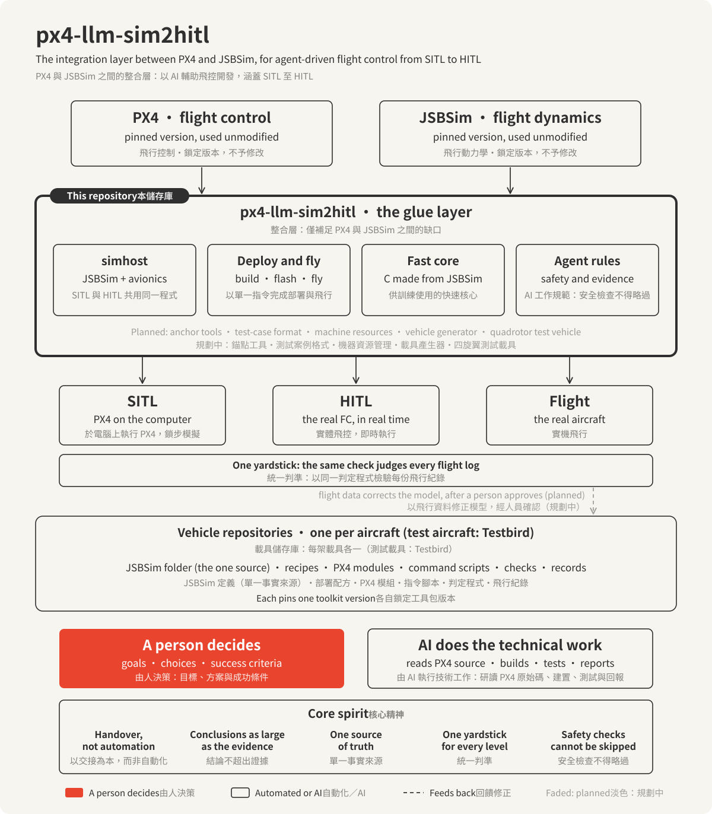

# px4-llm-sim2hitl

以 AI agent 為主要操作者的 PX4 飛控開發整合層。飛行動力學採用 JSBSim，飛控採用 PX4，提供從 SITL 到實體飛控 HITL 的一致工作流程，適用於各類載具。

[English](README.md) | **繁體中文**（翻譯；以英文版為準）

> 狀態：v2 草稿，開發中。v1（Simulink → C → HITL）封存於 tag `v1-final` 與分支 `legacy-v1`。



*各載具儲存庫使用同一張圖，僅標示各自所在的層級（`images/mark_overview.py`）。*

## 概述

本專案位於 PX4 與 JSBSim 之間。兩者都以鎖定的原始版本使用，不修改、不分叉；本專案只實作兩者之間缺少的部分：

- HITL 即時模擬
- 部署流程
- 跨層一致的驗證方法
- 供 AI agent 遵循的開發規範

載具各自以獨立的儲存庫維護，並鎖定本專案的版本。本專案不含任何實際載具，只附測試載具。

## 設計原則

- **建立在成熟專案之上**：PX4 與 JSBSim 已提供的功能不重新實作。既有模組可用即沿用，不足時才擴充。
- **整合層只補缺口**：負責 HITL 即時節拍與實機安全、部署流程、SITL 與 HITL 的一致驗證，以及 agent 開發規範。
- **載具與工具分離**：載具定義、任務與飛行紀錄屬於載具儲存庫；本專案只放通用工具與測試載具。
- **交接，而非自動化**：每個新的 agent 對話都等同一位新成員到職。文件說明以下各點，讓 agent 遇到異常時能定位原因，而不是繞過檢查：
  - 系統如何運作
  - 已知問題
  - 已驗證的範圍
  - 需要人決定的事項

  工具是既有理解的固化：同一流程重複兩三次後，才轉成指令。
- **結論與證據相稱**：每項結論都註明依據（哪次測試、哪份紀錄）與適用範圍（版本、配方、飛控、模式），證據不足時縮小結論範圍。SITL 與 HITL 結果一致，不代表模型等同實機。
- **統一判準**：SITL、HITL 與實飛使用相同的情境、判定程式與紀錄格式（ULog）。各層之間的差異本身就是待查的資訊。
- **單一來源**：每項資訊只存在一處，也不為尚未出現的需求預先設計。
- **環境不寫死，驗收標準寫死**：路徑、編譯器與 PX4 原始碼樹自動偵測，也可另外指定；版本鎖、容差與時序門檻則不隨環境改變。
- **安全檢查不可繞過**：飛控身分、未解鎖狀態、參數讀回與恢復程序為強制項目。其餘非預設設定照常執行並記錄，異常由 agent 回報、由人決定。
- **人決定方向，agent 負責技術**：目標、方案選擇與成功條件由人決定；技術查證與實作由 agent 負責，並以使用者慣用的語言回報。

## 架構

```
  PX4（飛控）          JSBSim（飛行動力學）     上游專案：鎖定版本，不修改
           \            /
        px4-llm-sim2hitl（整合層）           本儲存庫
                 |  鎖定版本使用
   載具儲存庫：每架載具各一                    載具定義、任務、紀錄
```

## 支援載具

凡 JSBSim 能描述的載具都在支援範圍內，例如固定翼、多旋翼、VTOL 與直升機。本專案將以兩台測試載具（固定翼、四旋翼）驗證所有介面，避免介面隱含特定的載具形式；固定翼（`vehicles/testbird`）已完成，四旋翼規劃中。實際支援以驗證矩陣為準，未經驗證的組合不算支援。**目前的流程與檢查僅涵蓋固定翼**：飛手程式執行固定翼跑道起飛，載具檢查以固定翼配平，simhost 以固定的 250 Hz HIL 頻率運行。待第二種載具實際納入時再行擴充，不預先設計。

## 功能

已完成並驗證的項目見 [docs/verification.md](docs/verification.md)；標示「規劃中」的尚未完成。

- **模擬主機**：JSBSim 加上航電模型（感測器、舵機訊號鏈），以 PX4 標準 HIL MAVLink 訊息通訊。連接 PX4 SITL 即為 SITL，連接飛控即為 HITL，兩者是同一個程式。
- **部署流程**：編譯 → 燒錄 → 身分核對 → 參數 → 開機檔 → HITL → 飛控紀錄，以單一指令完成（`tools/fly.py`；配方格式見 [docs/recipes.md](docs/recipes.md)）。
- **測試案例**（規劃中）：情境、判定與紀錄格式統一，適用於演算法層、SITL、HITL 與實飛。目前由配方的 `hitl.json` 指定指令腳本與判定，紀錄由載具儲存庫保存。
- **錨點**（規劃中）：記錄載具的參考行為並加以鎖定，變更須經人確認。
- **快速核心**（選用）：由載具的 JSBSim 定義產生的 C 版模型，並與 JSBSim 比對驗證，供訓練等需要大量模擬時數的工作使用。其轉譯範圍為 JSBSim 的一個子集（見 `fastcore/README.md`）；載具檔案若使用子集以外的元件，暫時無法使用。
- **本機資源管理**（規劃中）：多個載具儲存庫共用同一台電腦時，協調飛控、SITL 實例與 PX4 原始碼樹的使用。
- **載具產生器**（規劃中）：建立新的載具儲存庫。

## 開發流程

1. **需求與規格**：定義目標與成功條件。agent 先閱讀鎖定版本的 PX4 原始碼，提出可行的整合方式供人選擇，並建議先完成一次最小打通。
2. **SITL**：在電腦上反覆驗證。
3. **HITL**：以部署流程在實體飛控上驗證。
4. **實飛與回饋**（規劃中）：以飛行資料修正載具模型，並經人確認後更新錨點。

## 快速開始

將本儲存庫的網址提供給 AI agent（例如 Claude Code、Codex），並說明目標。

- **新載具**：建立載具儲存庫（載具產生器完成前，以 `vehicles/testbird` 的結構與 [docs/recipes.md](docs/recipes.md) 為起點），先以測試載具完成 SITL → HITL。
- **既有載具**：在該載具儲存庫內開發，不需要直接修改本專案。

## 語言

- README 以英文版為正式版本，本文件是翻譯；兩者不一致時，以英文版為準。
- 其餘文件（`AGENTS.md`、各資料夾說明、程式註解、commit 訊息）一律使用英文，只維護單一版本。
- agent 與人溝通時，使用對方慣用的語言，術語依照術語對照表（規劃中）。

## 授權

BSD 3-Clause，見 [LICENSE](LICENSE)。PX4（BSD 3-Clause）與 JSBSim（LGPL-2.1）依各自的授權原封不動使用；JSBSim 由鎖定版本的原始碼編譯。
