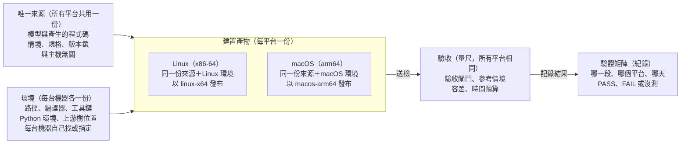

# macOS 開發平台建議書

> 用途：macOS（Apple Silicon）和 Ubuntu 不同的平台行為、怎麼確認，以及接實機前要知道的。
> 什麼時候讀：在 Mac 上設定或跑這套流程時。
> 可以跳過：在 Ubuntu 上工作時。
> 小節：給 AI agent 的讀法｜實跑紀錄（已搬到帳本 V20）｜平台差異放在哪一層｜macOS 平台理解｜接實機前要先知道的｜常用小工具｜核心原則｜上線檢查表｜驗證矩陣｜待決與後續

2026-10-20，在一台 Mac 上實際跑到 SITL 後整理。驗證到哪一段，見[根目錄 README](../README.md)的「驗證矩陣」。

結論：Apple Silicon 的 Mac 可以原生跑完「MATLAB 產碼 → 模型驗收 → PX4 SITL」，驗收數字和 Linux 的紀錄相同。和 Linux 不同的地方集中在幾個平台行為：處理器指令集、動態函式庫的載入路徑、資料夾的用途、排程與電源、工具鏈與 shell、程序管理。本文是在一台 Mac 上實際跑到 SITL 之後整理的；實機迴路（HITL）還沒測。

適用：用 MATLAB/Simulink 產碼、PX4 SITL 與 PX4 韌體開發，並用文件把流程交接給 AI 的專案。驗證機：Apple M4（4 效能核心＋6 節能核心）、macOS 27.0.1、Apple clang 21、Homebrew 6、MATLAB R2026b、PX4 v1.17.0。

## 給 AI agent 的讀法

- 這是平台理解，不是安裝腳本：安裝時照「工具鏈、Homebrew 與 Python」的原則，重讀上游當下的官方說明，不要照抄指令。
- 每一條「例」都是 2026-10-20 在一台 Mac 上實際觀察到的；「接實機前要先知道的」一節還沒測。
- 遇到和本文不同的現象：先查證、保留證據，再提議更新本文或專案的交接文件，由人決定。

## 實跑紀錄

搬到 [records/verification.md](../records/verification.md) 的 V20。

## 平台差異放在哪一層

macOS 的差異只出現在環境與建置產物：唯一來源與驗收標準兩個平台共用。這次 Mac 用同一份生成碼、同一組檢查，以 macos-arm64 的名義另外發布一份。

## macOS 平台理解

每一項寫 macOS 怎麼做、對這類開發有什麼影響、怎麼確認；「例」是這次實際遇到的。

### 處理器：Apple Silicon 就是 arm64

- 只跑 arm64。這台 macOS 27 沒有裝 Rosetta 2，x86_64 程式一執行就是 `Bad CPU type`；Apple 也已宣布 macOS 27 之後縮減 Rosetta。
- 影響：只能在 x86 上編的東西（SSE、AVX 指令）要在來源修掉，不靠 Rosetta 繞。
- 確認：`uname -m`、`lipo -archs <檔案>`。
- 例：產碼目標設成 Intel 時，MATLAB R2026b 預設 `InstructionSetExtensions = {'SSE2'}`，生成碼會 `#include <emmintrin.h>`，Mac 編不過；設成 `'None'` 後兩邊都能編。

### 產碼與浮點

- 不用特別產「Apple 專用」的碼：編譯器會在不改變結果的地方自己用 NEON。產成 NEON 專用的碼，換成 Intel 就編不過。
- clang 預設允許把乘加合成一個指令（arm64 一定有 FMA），結果會差最後一位；要和其他平台比，就加 `-ffp-contract=off`、不用 fast-math。
- 不同平台的數學函式庫（sin、exp…）最後一位可能不同：跨平台用容差比，同一平台內的重跑才要求逐位元相同。
- 例：Mac 編的核心對舊 Mac 錄的參考資料，最大誤差 2.2e-16；Linux 對同一份資料是 6.2e-15。

### 動態函式庫與簽章

- dylib 會記住編譯時的路徑（install name，預設就是 `-o` 給的路徑）。執行檔記下的是這個路徑，不是連結時用的那份檔案。
- 影響：dylib 複製到別處再連結，執行時仍去原處載入；原處被刪就是 `Library not loaded`。Linux 沒有這個行為。
- 做法：編譯時用 `-install_name @rpath/<名字>`。用 CMake 連結時，它看到 `@rpath` 的名字會自己給執行檔加一條指到 library 所在資料夾的 rpath，不用再手動加（多加一條會出現 `duplicate -rpath` 警告）；建置後用 `otool -L` 與 LC_RPATH 核對。
- arm64 上所有程式碼都要簽章，連結器會自動加 ad-hoc 簽章。事後改二進位（例如 `install_name_tool`）後用 `codesign -dv` 檢查，必要時 `codesign -f -s -` 重簽。
- 確認：`otool -L`、`otool -D`、`otool -l | grep -A2 LC_RPATH`、`codesign -dv`。
- 例：PX4 執行檔連結的是發布資料夾裡的函式庫，`otool -L` 卻顯示它會從建置暫存區載入；簽章是 `adhoc, linker-signed`。install name 改成 `@rpath` 後，執行檔的 LC_RPATH 多了發布資料夾，載入的就是發布的那份。

### 資料夾與檔案系統

- `~/Library/Caches` 可以被刪（系統空間不足、清理工具）；要留下的放 `~/Library/Application Support`。macOS 預設沒有設 XDG 變數。
- 安全狀態（恢復記號、鎖檔、交易記號）放 Application Support，不放 Caches。
- `Application Support` 中間有空格：指令裡的路徑一律加引號。
- APFS 預設不分大小寫。外接磁碟的路徑是 `/Volumes/<名稱>`，沒掛上就不存在；exFAT、FAT 會產生 `._*` 檔，不要放原始碼樹。
- Finder 會在看過的資料夾留下 `.DS_Store`：用全域 gitignore（`~/.config/git/ignore`）忽略，否則子模組會變髒。
- 雲端同步資料夾（`~/Library/CloudStorage`、iCloud 的「文件」）會讓檔案「只在雲端」、讀到才下載：原始碼樹、狀態、建置都不要放這裡。
- 例：這次用的工具把建置暫存和 runtime 的安全狀態都放在 Caches，而這台機器裝了會清 Caches 的清理工具。

### 排程、時序與電源

- 即時執行緒用 mach 的 time-constraint policy，一般使用者就能設，不需要 root；Linux 的 SCHED_FIFO、`ulimit -r`、`prlimit`、systemd 設定在 macOS 都沒有。
- App Nap 與計時器合併會延後背景程式的計時器：長時間的即時迴圈要用 `NSProcessInfo` 的 activity（latency critical）或 `caffeinate` 擋住。低電量模式也會降速。
- 螢幕關閉或系統睡眠會停下迴圈：長測試前看 `pmset -g assertions`，或用 `caffeinate -i` 包住。
- 例：60 秒、每步 4 ms 的節拍測試，沒有做任何權限設定：0 次晚到，P99 步長 36.9 µs，最慢晚 116 µs。同一個測試在 Linux、沒有即時權限時，最慢晚 287 µs。

### 工具鏈、Homebrew 與 Python

- 只裝 Xcode Command Line Tools 就有 clang（`cc` 就是 Apple clang）。MATLAB 只產碼時不需要完整 Xcode，但會警告找不到支援的編譯器。
- Homebrew 6 起，第三方 tap 要先 `brew trust`。上游可能把整合套件改成空殼，`brew autoremove` 還會拿掉原本靠它拉進來的套件。照上游**現在**的安裝腳本列的套件裝：鎖定的是原始碼版本，不是安裝說明。
- Homebrew 的 cmake 已經是 4.x：宣告 `cmake_minimum_required` 低於 3.5 的專案會被拒絕，可用 `CMAKE_POLICY_VERSION_MINIMUM=3.5` 試著繼續。
- Python：系統的 `/usr/bin/python3` 是 3.9；Homebrew 的 Python 受 PEP 668 保護，`pip install --user` 會被擋。用 venv（例如 uv），放在上游原始碼樹外，再用環境變數指給建置。
- 新的 Mac 上 git 沒有 `user.name`／`user.email`，鑰匙圈裡也沒有 GitHub 憑證：commit 前先設好身分（可以只設在這個 repo），要推到 GitHub 前由本人跑一次 `gh auth login`。
- 例：PX4 v1.17 的 macOS 腳本靠 `px4-dev`，它自 2026 年 4 月起什麼都不裝；v1.17 的文件還叫 Apple Silicon 用 Rosetta 終端機。現在的 main 改成明列套件、把 Python 裝進樹內的 `.venv`，但 v1.17 的 `.gitignore` 沒忽略 `.venv`，照做會讓乾淨度檢查失敗。

### Shell 與指令列工具

- 預設 shell 是 zsh：沒加引號的變數不會拆成多個字，`set -- $x`、`for a in $x` 都和 bash 不同。
- `/bin/sh` 是 bash 3.2：啟動腳本用 POSIX 寫法，不用 bash 4 以後的語法。
- 指令列工具是 BSD 版：`sed -i ''`、`grep` 沒有 `-P`、`rsync` 是 openrsync（相容 2.6.9）、沒有 `/proc`；`sha256sum` 新版才有，舊版用 `shasum -a 256`。
- 沒有 GNU 的 `timeout`（coreutils）：要限制時間的指令，用程式自己的逾時，或另外裝 coreutils。
- 例：一段批次指令在 zsh 下沒有拆字，參數全部擠在一起，程式直接報錯；用 `timeout 30 git push` 測推送，直接 `command not found`。

### 程序與多實例

- 開檔上限預設很低（`ulimit -n` 常是 256）；大型建置建議 2048 以上，寫在 `~/.zshenv`。
- 強制結束（SIGKILL）一個程序，不會帶走它啟動的子程序：子程序變成孤兒，繼續執行。用同一個編號重啟實例前，要結束整個程序群組（例如 Python 的 `start_new_session` 加 `os.killpg`）。
- PX4 posix 版用 `/tmp/px4-sock-<編號>` 與 `/tmp/px4_lock-<編號>` 區分實例；被強制結束後這些檔案會留下，下次啟動會重建 socket。
- 例：第一批 25 個實例有一個卡住，啟動指令回報 `PX4 server not running`。實驗確認 PX4 被 SIGKILL 後，它的啟動腳本還會把剩下的指令跑完。之後又出現過幾次（重新連結後的第一批、100 個同時跑），卡住的位置不固定（腳本剛開始、`param select` 之後、`param import` 之後）：PX4 posix 版的指令在很多實例同時啟動時偶爾不回應。執行器改成整組結束、重啟並保留失敗那次的 log 後，每次都能跑完。

## 接實機前要先知道的

這一節還沒測，是依 macOS 的慣例整理的。第一次在 Mac 上接飛控時，逐項確認後再寫成紀錄。

- 序列埠：USB CDC 裝置會同時出現 `/dev/cu.usbmodem*` 和 `/dev/tty.usbmodem*`。主動連線用 `cu.*`；`tty.*` 開啟時會等載波訊號。名稱跟裝置序號與插槽有關，不要寫死。
- 序列埠權限：不需要 `dialout` 群組，也沒有 ModemManager。但地面站等程式的自動連線會搶埠，要關掉。
- 即時與電源：time-constraint 不需要權限；測試期間要擋住 App Nap、睡眠與低電量模式，筆電插上電源。
- 安全狀態：恢復記號、鎖檔、交易記號不要放在 `~/Library/Caches`，否則清理工具可能在沒人知道時刪掉它們。
- 隱私權限：終端機或 AI 工具第一次存取外接磁碟、文件、桌面時會跳權限詢問，沒人在旁邊時會卡住。macOS 15 起連區網內其他裝置會問「本地網路」權限；只用 localhost 不受影響。
- 確認：`ls /dev/cu.*`、`lsof /dev/cu.<名稱>`（誰佔用）、`pmset -g assertions`（誰擋住睡眠）。

## 常用小工具

都是只讀的檢查，把「應該是這樣」變成「查過是這樣」。同一組檢查做到第二、三次，再包成一個印出這台機器狀態的指令；不寫安裝腳本。

| 要確認的事 | 指令 | 這次的結果 |
| --- | --- | --- |
| 處理器與 Rosetta | `uname -m`；`arch -x86_64 /usr/bin/true` | arm64；沒有 Rosetta |
| 檔案的架構 | `lipo -archs <檔案>` | PX4 執行檔只有 arm64 |
| 編譯器 | `xcode-select -p`；`cc --version` | 只有 Command Line Tools；clang 21 |
| 函式庫從哪裡載入 | `otool -L <執行檔>`；`otool -D <dylib>` | 指向建置暫存區 |
| 簽章 | `codesign -dv <檔案>` | adhoc、linker-signed |
| 原始碼樹乾淨 | `git status --porcelain`；`git submodule status --recursive` | 建置前後都乾淨 |
| 生成碼沒有 x86 指令 | `grep -c -E 'emmintrin\|immintrin\|_mm_' <生成碼>` | 0 |
| 開檔上限 | `ulimit -n` | 2048 |
| 殘留程序 | `pgrep -fl <名稱>` | 0 個 |
| 睡眠與節能 | `pmset -g assertions` | 沒測 |
| 序列埠與佔用 | `ls /dev/cu.*`；`lsof /dev/cu.<名稱>` | 沒測 |

## 核心原則

換平台時容易想「順便做成跨平台工具」；這幾條是擋住這件事的界線。

- **交接的是理解，不是自動化**：文件寫「為什麼、照哪一份官方來源、怎麼確認」；安裝時重讀上游當下的說明，不包一層自己的腳本。
- **平台是被驗證的，不是被支援的**：只記「哪一段、哪一台、哪一天驗證過」，其餘寫「沒測」。程式裡的平台分支要有驗證紀錄撐著。
- **唯一來源與主機無關**：生成碼不帶任何主機的指令集；一份來源，各平台自己建置，不為每個平台各產一份。
- **環境自己找或指定，驗收標準不變**：路徑、編譯器、Python 由每台機器決定；情境、檢查、容差、時間預算不因平台改。兩平台的差異記下來當資訊。
- **假設要變成檢查**：像「用的是發布的那份函式庫」這種不變量，建置後實際查。
- **工具跟著重複長出來**：只寫只讀的檢查；同一件事做兩三次再固定，由人決定。

## 上線檢查表

換到一台新的 Mac 時複製一份來勾，依執行順序排列。

- [ ] `uname -m` 是 arm64，確認不需要 Rosetta
- [ ] 裝好 Command Line Tools，`cc --version` 是 Apple clang
- [ ] 照上游**現在**的安裝腳本列的套件，用 Homebrew 安裝；第三方 tap 先 `brew trust`
- [ ] 上游原始碼樹乾淨、等於鎖定版本；不用 git worktree，不放雲端同步資料夾或 exFAT 磁碟
- [ ] 全域 gitignore 加上 `.DS_Store`
- [ ] Python venv 放在原始碼樹外，用環境變數指給建置
- [ ] `ulimit -n` 至少 2048
- [ ] 生成碼裡沒有 `emmintrin.h`、`immintrin.h` 這類 x86 標頭
- [ ] 浮點設定和其他平台一致：`-ffp-contract=off`、不用 fast-math
- [ ] 建置後用 `otool -L` 核對執行檔載入的函式庫
- [ ] 要保留的狀態不在 `~/Library/Caches`
- [ ] 跑驗收閘門與參考情境，結果和其他平台的紀錄並排
- [ ] 多實例先跑一批，確認沒有重啟與卡住
- [ ] 驗證矩陣補上這台，沒測的寫「沒測」

## 驗證矩陣

在[根目錄 README](../README.md)的「驗證矩陣」（只放一個地方）：每格只寫 PASS、FAIL 或沒測。

## 待決與後續

要人決定的：

- ~~關閉指令集擴充的生成碼，先在 Linux 重跑四道檢查與 SITL，結果不變才合併。~~ 2026-10-20 做完：數字每一位都和之前一樣，已合併。
- ~~動態函式庫的載入路徑：改成 `@rpath` 並在建置後核對，或接受執行檔依賴建置暫存區。~~ 2026-10-20 改成 `@rpath`，建置後自動核對（待合併）。
- ~~多實例的執行器：重啟前結束整個程序群組；把「有輸出檔但沒有進度」也當成卡住，不要等到全域逾時。~~ 2026-10-20 改好（待合併）：整組結束、停止前進也算卡住、保留失敗的 log。
- 接實機前，把安全狀態搬出 `~/Library/Caches`。
- ~~這次的坑與驗證矩陣要寫回哪一份專案文件。~~ 本檔，矩陣在根目錄 README。

還沒做的驗證：離線 runtime 測試、ULog 重播、300／600 秒負載測試、韌體編譯、實機迴路。
